# 🛠️ Awesome Developer Debugging & Network Profiling

  

  
  
  
  
  

---

## 📌 Ecosystem Overview & Guide

A curated directory of top **developer debugging tools**, **network profiling proxies**, **distributed tracing engines**, and **production observability platforms**. Designed for software engineers, site reliability engineers (SREs), DevOps architects, security researchers, and QA testers looking to intercept HTTP/1/2/3 traffic, analyze packets, profile memory leaks, trace microservices, and capture runtime application errors.

---

## 📊 Sector Overview & Market Dynamics

The global observability and developer debugging market is valued at approximately **$2.9B to $11.8B in 2025–2026** (projected to reach over **$13.4B+** growing at ~14–15% CAGR), driven by microservices complexity, cloud-native Kubernetes workloads, and emerging AI/LLM tracing requirements. The sector is **moderately fragmented**: anchored by an established enterprise oligopoly at the top (Datadog, Dynatrace, Cisco/Splunk, Progress, Sentry), yet continually diversified by open standards like OpenTelemetry and an active open-source ecosystem that prevents a winner-take-all monopoly and allows specialized debugging tools to thrive.

---

## 📑 Table of Contents
- [📊 Sector Overview & Market Dynamics](#-sector-overview--market-dynamics)
- [☁️ SaaS & Hosted Platforms](#️-saas--hosted-platforms)
- [💻 Open-Source GitHub Projects](#-open-source-github-projects)
- [🤝 How to Contribute](#-how-to-contribute)
- [💖 Support](#-support)
- [⚠️ Disclaimer](#️-disclaimer)
- [📈 Star History](#-star-history)

---

## ☁️ SaaS & Hosted Platforms

*Sorted by company scale (valuation / market capitalization / revenue descending).*

| Product | Company Scale (Valuation / Revenue) | Description | Pricing (Starting) | Free Tier / Trial Limits |
|---------|------------------------------------|-------------|-------------------|--------------------------|
| **[Datadog APM](https://www.datadoghq.com/)** | **~$60B–$70B Market Cap** (Public: NASDAQ: DDOG; ~$3.43B FY25 Revenue, guidance ~$4.5B FY26) | Full-stack observability with APM, infrastructure monitoring, log management, and distributed tracing. APM requires underlying host infrastructure monitoring. | Infrastructure starting tier: Pro at **$15/host/month** (annual) or **$18/host/month** (on-demand); APM starting tier: Standard at **$31/host/month** (annual) or **$36/host/month** (on-demand) [Baseline total: **$46/host/month** annual]. | **Free Infrastructure plan (Free forever)**: Up to 5 hosts, 1-day metric retention (excludes APM); **APM Free trial**: 14-day fully featured trial with unlimited hosts and metrics. |
| **[Sentry](https://sentry.io/)** | **~$3.0B Valuation** (Series E unicorn backed by Accel & BOND; ~$100M–$130M ARR) | Developer-first production error tracking and application performance monitoring with stack traces, breadcrumbs, session replay, and distributed tracing. | Developer: **$0/month**; Team starting tier: **$26/month** (annual) or **$29/month** (monthly); Business starting tier: **$80/month** (annual). | **Developer (Free forever)**: 5,000 errors/month, 10,000 transactions (5M spans)/month, 50 session replays/month, 1 user, 30-day data retention, 10 dashboards; **Free trial**: 14-day trial with full feature and unlimited event access. |
| **[Fiddler Everywhere](https://www.telerik.com/fiddler)** | **~$1.8B Market Cap** (Parent: Progress Software Corp, NASDAQ: PRGS; ~$1.0B TTM Revenue) | Cross-platform web debugging proxy with traffic capture, inspection, rules-based modification, and team collaboration. SOC 2, HIPAA, and GDPR compliant. | Lite starting tier: **$7/user/month** (annual commitment) or **$10/user/month** (monthly); Pro starting tier: **$13/user/month** (annual) or **$19/user/month** (monthly); Enterprise tier: **$37/user/month** (annual). | **Free trial only**: 10-day fully functional free trial with full feature access and unlimited captures; no ongoing perpetual free tier (legacy non-commercial Fiddler Classic is Windows-only). |
| **[Proxyman](https://proxyman.com/)** | **Bootstrapped / ~$900K+ ARR** (Independent software developer / self-funded indie business) | Native macOS/Windows/Linux HTTPS debugging proxy with iOS companion app. SSL proxying, breakpoints, Map Local/Remote, scripting, and network condition simulation. | Standard desktop perpetual license: **$89 one-time fee** (1 seat / 1 active device, lifetime access with 1 year of free updates); iOS Premium from **$12.98/month**. | **Free version (Free forever for personal use)**: Unlimited duration for non-commercial use, restricted to 1–2 rules per advanced tool (Breakpoints, Map Local/Remote, Scripting, SSL Proxying list), and max 2 pinned domains/apps; **Commercial trial**: 14 days full evaluation before requiring a Pro license. |
| **[Charles Proxy](https://www.charlesproxy.com/)** | **Privately Held / Bootstrapped** (XK72 Ltd; estimated micro-entity ARR under $1M) | Long-standing HTTP/HTTPS debugging proxy with SSL proxying, bandwidth throttling, breakpoints, rewrite rules, and AJAX/AMF inspection. | Single-user perpetual license: **$50 one-time fee** (includes all v5.x updates; major upgrades at 40% discount). | **Free trial**: 30-day evaluation period; after 30 days, continuous use is restricted to 30 minutes per session with automated application shutdown and a startup delay nag screen. |

---

## 💻 Open-Source GitHub Projects

*Sorted strictly by GitHub Stars_Count in descending order. Stars_Badges link directly to each repository's stargazers page.*

| Project | GitHub_Stars | Category | Description |
|---------|-------|----------|-------------|
| **[mitmproxy](https://github.com/mitmproxy/mitmproxy)** |  | 🌐 Intercepting HTTP/HTTPS Proxy | **The standard scriptable intercepting proxy for automated traffic manipulation.** Interactive SSL/TLS-capable proxy for HTTP/1, HTTP/2, HTTP/3, and WebSockets. Intercept and modify requests/responses on the fly, save conversations for replay, and use Python scripts to automate changes. |
| **[Glances](https://github.com/nicolargo/glances)** |  | 🖥️ System & Network Profiler | **Top cross-platform system, process, and network monitoring tool.** Written in Python with an interactive terminal UI and web dashboard. Provides real-time metrics for CPU, memory, network interfaces, I/O disks, containers (Docker/Podman), and processes. |
| **[SigNoz](https://github.com/SigNoz/signoz)** |  | 📈 APM & Observability | **OpenTelemetry-native observability platform—the leading open-source Datadog alternative.** Single application for logs, metrics, and traces built on ClickHouse for ultra-fast querying. Features distributed tracing flamegraphs, p99 latency dashboards, and LLM observability. |
| **[Jaeger](https://github.com/jaegertracing/jaeger)** |  | 🔍 Distributed Tracing | **CNCF graduated end-to-end distributed tracing system.** Originally developed by Uber Technologies. Used for monitoring microservice architectures, root cause analysis, distributed context propagation, and service dependency analysis. |
| **[FlameGraph](https://github.com/brendangregg/FlameGraph)** |  | 🔥 Stack Trace Profiling | **Industry-standard visualization for profiled software execution paths.** Created by Brendan Gregg. Converts Linux perf, DTrace, SystemTap, or eBPF profiling outputs into interactive SVG flamegraphs to rapidly pinpoint CPU bottlenecks and code paths. |
| **[OWASP ZAP](https://github.com/zaproxy/zaproxy)** |  | 🛡️ Security & DAST Proxy | **The world's most widely deployed open-source DAST proxy.** Intercepting proxy with passive and active security scanning, automated spiders, and CI/CD baseline vulnerability testing for web applications and APIs. |
| **[Whistle](https://github.com/avwo/whistle)** |  | 🔀 Web Debugging Proxy | **Cross-platform web debugging proxy tool based on Node.js.** Supports inspecting and modifying HTTP, HTTPS, WebSocket requests/responses, domain/host rebinding, Map Local/Remote, and flexible rule-based manipulation. |
| **[py-spy](https://github.com/benfred/py-spy)** |  | ⚡ Sampling Profiler | **Zero-overhead sampling profiler for Python programs.** Lets you visualize what your Python code is spending time on without restarting the application or modifying source code. Outputs interactive flamegraphs and top-like process views. |
| **[Memray](https://github.com/bloomberg/memray)** |  | 🧠 Memory Profiling | **High-performance memory profiler for Python by Bloomberg.** Tracks allocations in Python code, native C/C++ extension modules, and libraries. Generates detailed HTML flamegraphs and reports to eliminate memory leaks. |
| **[Flipper](https://github.com/facebook/flipper)** |  | 📱 Mobile App Debugging | **Desktop debugging platform for mobile developers by Meta.** Inspects network traffic, layout hierarchies, logs, shared preferences, and SQLite databases for iOS, Android, and React Native applications. |
| **[Pyroscope](https://github.com/grafana/pyroscope)** |  | 📊 Continuous Profiling | **Continuous profiling platform by Grafana Labs.** Collects CPU, memory, and mutex profiles from applications across Go, Java, Python, Rust, and Node.js with minimal CPU overhead; natively integrates with Grafana. |
| **[Wireshark](https://github.com/wireshark/wireshark)** |  | 📡 Protocol Analyzer | **The world's leading network protocol analyzer.** Deep packet inspection across 1,000+ protocols, live capture, offline analysis, TCP stream reassembly, and deep packet dissection across Ethernet, WiFi, Bluetooth, and USB. |
| **[async-profiler](https://github.com/jvm-profiling-tools/async-profiler)** |  | ☕ JVM Low-Overhead Profiler | **Low-overhead sampling profiler for Java that does not suffer from Safepoint bias problem.** Profiles CPU, heap allocations, memory leaks, lock contentions, and kernel tracepoints, producing interactive flamegraphs. |
| **[Fluent Bit](https://github.com/fluent/fluent-bit)** |  | 🪵 Telemetry & Log Processor | **Fast and lightweight log processor and telemetry pipeline engine.** Written in C for maximum throughput and low memory footprint. Collects, parses, filters, and forwards logs, metrics, and traces to any backend storage or APM. |
| **[OpenTelemetry Collector](https://github.com/open-telemetry/opentelemetry-collector)** |  | 🔭 Observability Pipeline | **Vendor-neutral proxy and processing pipeline for telemetry data.** Receives, processes, filters, transforms, and exports telemetry (metrics, traces, and logs) across any cloud provider or APM platform without vendor lock-in. |
| **[WireMock](https://github.com/wiremock/wiremock)** |  | 🧪 Mocking & API Interception | **Flexible tool for building mock HTTP services and stubbing API interactions.** Enables rapid testing of edge cases, slow network latency, fault injection, and dynamic response templating for microservices. |
| **[MockServer](https://github.com/mock-server/mockserver)** |  | 🛠️ Mocking & Proxy | **Easy mocking and proxying of HTTP and HTTPS traffic.** Inspects, records, and verifies incoming requests from any client, simulates system failures, network latency, and proxies traffic with dynamic SSL/TLS interception. |
| **[Betwixt](https://github.com/kdzwinel/betwixt)** |  | 🌐 Network Monitor | System-wide network monitor and web debugging proxy. Captures traffic from any installed desktop application and renders it in a familiar Chrome DevTools-compatible interface with MITM HTTPS decryption. |
| **[HTTP Toolkit](https://github.com/httptoolkit/httptoolkit)** |  | 🎯 Interactive HTTP Proxy | **100% open-source alternative to Charles Proxy and Fiddler.** One-click traffic interception for browsers, Android, Docker, Node.js, Python, and CLI with built-in Monaco editor, breakpoints, and rules engine. |
| **[Front-end Debugging Handbook](https://github.com/lala-hakobyan/front-end-debugging-handbook)** |  | 📚 Developer Reference | Practical developer guide and handbook for front-end debugging across browser DevTools, modern JavaScript framework extensions, and IDE workflows. |

---

## 🤝 How to Contribute

Contributions are warmly welcomed! Help keep this ecosystem comprehensive, factual, and up to date:

1. **Fork the repository** to your personal GitHub account.
2. **Add or edit entries** in `README.md` following the established tabular structure.
3. **Include key details**: Product/project name, official documentation or repository link, category, exact pricing tier (for SaaS), and a factual 1–2 sentence description.
4. **Submit a Pull Request** describing your additions or changes.

---

## 💖 Support

Thank you for exploring and utilizing the **Awesome Developer Debugging & Network Profiling** list! If this resource helps streamline your debugging workflow, pinpoint network issues, or optimize your observability stack:

- ⭐ **Star this repository** to support project visibility.
- 🍴 **Fork and share** with your teammates, engineering community, or DevOps channels.
- ☕ **Buy a coffee & sponsor**: Consider supporting continued maintenance and updates through the [GitHub Sponsor Dashboard](https://github.com/sponsors/ishandutta2007).

---

## ⚠️ Disclaimer

- This is an **independent community-curated directory** provided for educational and technical evaluation purposes. Inclusion does not constitute an endorsement.
- **Traffic Interception Security**: Debugging proxies intercept sensitive unencrypted network traffic including credentials, API keys, and session tokens. Only intercept network traffic you own or have explicit administrative permission to inspect. Remove root CA certificates from test machines when debugging sessions end.
- **SaaS Pricing Transparency**: SaaS APM and telemetry pricing models compound dynamically across logs, traces, and metrics. Always check official vendor pricing pages and set hard spending caps on pay-as-you-go tiers to avoid unexpected overages.

---

## 📈 Star History

